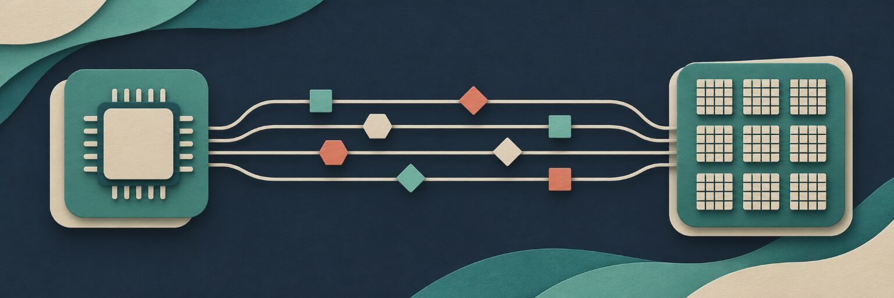

# SEC-PPDL

## About

SEC-PPDL is the PKU SEC Lab C++ library for two-party private neural network inference. Combine homomorphic encryption (HE) for linear layers with secure multiparty computation (MPC) for activations and comparisons. Applications can link individual operators or use the shared protocol runtime.

[Quick start](#quick-start) · [Operator usage](#usage) · [Experiments](#performance) · [Publications](#publications) · [Contributor guide](CONTRIBUTING.md)

## News

- OptiPrime (MICRO 2026) adds OptiEncode convolution on CPU and CUDA. The repository also includes a subsequent packed depthwise extension for MobileNetV2. [Project page](https://jerryfishy.github.io/OptiPrime/) · [Depthwise layout](Experiments/OptiPrime/depthwise.md)

## Current support

| Component | Available in the library | Entry point |
|---|---|---|
| Encrypted convolution | OptiEncode dense and multiplier-one depthwise convolution on CPU and CUDA; Cheetah and block-circulant convolution | [OptiEncode](Layer/LinearLayer/include/LinearLayer/ConvOptiEncode.h) · [Other convolutions](Layer/LinearLayer/include/LinearLayer/Conv.h) |
| Linear algebra | Packed matrix multiplication and block-circulant linear layers | [Linear](Layer/LinearLayer/include/LinearLayer/Linear.h) · [CirLinear](Layer/LinearLayer/include/LinearLayer/CirLinear.h) |
| Secure nonlinear operators | ReLU, pooling, fixed-point comparison, selection and truncation | [Layers](Layer/NonlinearLayer/include/NonlinearLayer) · [Fixed-point protocols](Operator/NonlinearOperator/include/NonlinearOperator/FixPoint.h) |
| Two-party runtime | HE key setup, IKNP or Ferret OT, communication counters | [Runtime](Runtime/include/Runtime/Primitive.h) |

## Quick start

From a fresh clone, follow the [dependency build instructions](Extern/README.md). These commands build the CPU library, then enable a two-party convolution check with generated inputs.

```bash
cmake -S . -B build -DCMAKE_BUILD_TYPE=Release
cmake --build build -j8
cmake -S . -B build -DBUILD_TESTING=ON
cmake --build build --target test_optiencode_conv -j8
ctest --test-dir build -R '^optiencode_conv$' --output-on-failure
```

Use `-DSEC_PPDL_BUILD_EXPERIMENTS=ON` for end-to-end models and benchmarks. Use a separate `build-gpu/` directory with `-DUSE_HE_GPU=ON` after installing the [GPU dependency](Extern/README.md#gpu-dependency).

## Usage

Link `LinearLayer` in your CMake application. On each party, supply an initialized HE context and a local input share. The server supplies OIHW weights and per-channel bias. The client supplies zero tensors of the same shapes.

```cpp
#include <LinearLayer/ConvOptiEncode.h>

he.GenerateNewKey(LinearLayer::Conv2DOptiEncode::GaloisElements(he.polyModulusDegree));
LinearLayer::OptiEncodeOptions options;
options.threads = 16;
LinearLayer::Conv2DOptiEncode conv(height, stride, padding, weights, bias, &he, options);
auto output_share = conv(input_share);
```

For a power-of-two plaintext modulus, set `options.ciphertext_inverse_normalization = true` on both parties. For depthwise convolution, set `options.depthwise = true` and supply weights shaped `[channels, 1, kernel, kernel]`. [Two-party example and plaintext reference](Test/support/OptiEncodeCases.h)

## Performance

| Experiment | What is measured |
|---|---|
| [OptiPrime ImageNet](Experiments/OptiPrime/README.md#performance) | CPU LAN/WAN latency, bidirectional traffic, and measured ResNet-18 integer plaintext and encrypted top-1/top-5 accuracy |
| [FaceResNet64](Experiments/FaceResNet/README.md) | Single-image embedding and two-image verification; fixed-point backbones and Compact W4A8 drivers |
| [Operator benchmarks](Experiments/Benchmarks/README.md) | Per-call timing and traffic for encrypted convolutions, and block-circulant matrix operation counts |
| [Falcon depthwise comparison](Experiments/OptiPrime/falcon/README.md) | Layer-level packing, operation counts and MobileNetV2 comparison |

Each experiment documents its own network settings, timing boundaries and units.

## Publications

### Papers and components implemented here

| Venue | Paper | Scope in this repository |
|---|---|---|
| MICRO 2026 | [OptiPrime](https://arxiv.org/abs/2609.16898) | [OptiEncode convolution](Layer/LinearLayer/include/LinearLayer/ConvOptiEncode.h) |
| USENIX Security 2025 | [Breaking the Layer Barrier](https://www.usenix.org/conference/usenixsecurity25/presentation/xu-tianshi) | [CKKS encoding primitives](Operator/LinearOperator/include/LinearOperator/Polynomial.h) and [linear-operator checks](Test/src/TestLinearOperator.cpp) |
| NeurIPS 2024 | [PrivCirNet](https://proceedings.neurips.cc/paper_files/paper/2024/file/ca9873918aa72e9033041f76e77b5c15-Paper-Conference.pdf) | [Block-circulant linear layers](Layer/LinearLayer/include/LinearLayer/CirLinear.h) and [convolution](Layer/LinearLayer/src/CirConv.cpp) |

The library also includes implementations of selected operators from these comparison methods.

| Venue | Method | Implemented component |
|---|---|---|
| NDSS 2025 | [BumbleBee](https://doi.org/10.14722/ndss.2025.230057) | [Shared-input matrix multiplication using HE cross terms](Layer/LinearLayer/src/Linear.cpp) |
| IEEE S&P 2024 | [BOLT](https://doi.org/10.1109/SP54263.2024.00130) | [Packed linear layer](Layer/LinearLayer/src/Linear.cpp) |
| ICCAD 2023 | [Falcon](https://arxiv.org/abs/2308.13189) | [Depthwise packing reproduction](Experiments/OptiPrime/falcon/README.md) |
| USENIX Security 2022 | [Cheetah](https://www.usenix.org/conference/usenixsecurity22/presentation/huang-zhicong) | [Encrypted convolution baseline](Layer/LinearLayer/src/ConvCheetah.cpp) |

### Research artifacts using SEC-PPDL

- **OptiPrime (MICRO 2026).** The released project links to SEC-PPDL for its code. Its ImageNet evaluation runs the library's operators end to end. [Project repository](https://github.com/PKU-SEC-Lab/OptiPrime) · [Evaluation](Experiments/OptiPrime/README.md)

To add a publication, include its venue, paper link, and the artifact or source that identifies its connection to SEC-PPDL.

## Citation

Please cite PrivCirNet and Breaking the Layer Barrier when using SEC-PPDL. If you use its OptiEncode convolution implementation, please also cite OptiPrime.

```bibtex
@article{xu2024privcirnet,
  title={Privcirnet: Efficient private inference via block circulant transformation},
  author={Xu, Tianshi and Wu, Lemeng and Wang, Runsheng and Li, Meng},
  journal={Advances in Neural Information Processing Systems},
  volume={37},
  pages={111802--111831},
  year={2024}
}

@inproceedings{xu2025breaking,
  title={Breaking the layer barrier: Remodeling private transformer inference with hybrid {CKKS} and {MPC}},
  author={Xu, Tianshi and Lu, Wen-jie and Yu, Jiangrui and Chen, Yi and Lin, Chenqi and Wang, Runsheng and Li, Meng},
  booktitle={34th USENIX Security Symposium (USENIX Security 25)},
  pages={2653--2672},
  year={2025}
}

@inproceedings{yu2026optiprime,
  title={{OptiPrime}: Optimizing Private Inference through Protocol-Hardware Co-design},
  author={Yu, Jiangrui and Yu, Ye and Chen, Si and Lin, Chenqi and Zeng, Wenxuan and Fan, Junfeng and Gao, Mingyu and Li, Meng},
  booktitle={Proceedings of the 59th IEEE/ACM International Symposium on Microarchitecture (MICRO)},
  year={2026},
  url={https://arxiv.org/abs/2609.16898}
}
```
